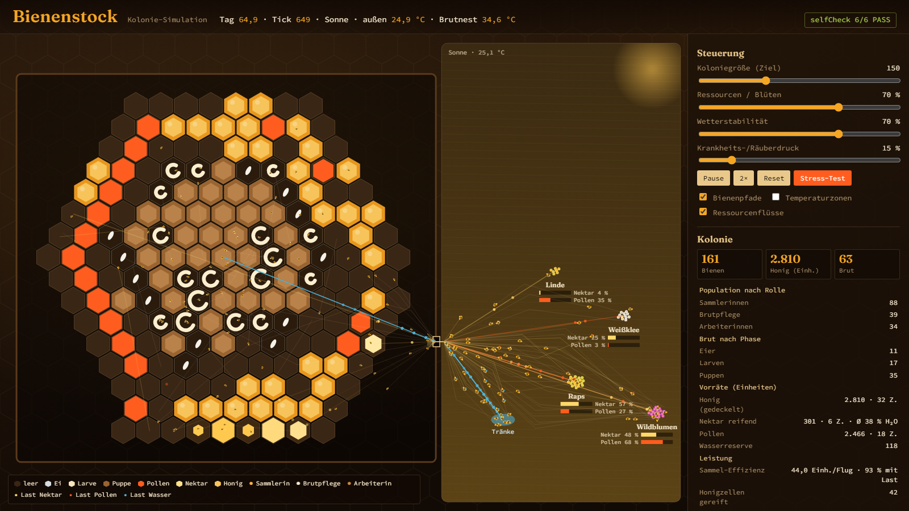

# Bienenstock-Simulation

Interaktive Simulation eines Bienenvolks als **eine einzige HTML-Datei**: HTML, CSS und JavaScript inline,
keine Frameworks, keine externen Dateien. Unter der Oberfläche stimmt die Systemlogik: Jede Einheit Nektar,
Pollen und Wasser wird verbucht, und Honig entsteht nur über die vollständige Prozesskette.



## Starten

1. Auf GitHub [`bienenstock.html`](bienenstock.html) öffnen.
2. Rechts oben auf **„Download raw file“** klicken (Pfeil-Symbol).
3. Die heruntergeladene Datei per Doppelklick öffnen. Sie läuft im Browser, es wird kein Server gebraucht.

## Was simuliert wird

- **Wabe:** wächst von 80 auf höchstens 1.200 Zellen, mit Brutnest innen, Pollenkranz und Honig außen.
  Es gibt sieben Zellzustände: leer, Ei, Larve, Puppe, Pollen, Nektar (mit Wassergehalt) und Honig (gedeckelt).
- **Honigkette:** Sammelflug, Übergabe am Flugloch, Einlagerung mit rund 60 % Wasser, Fächeln, Deckelung unter 20 %.
- **Brut:** Ei 3 Tage, Larve 6 Tage, Puppe 12 Tage. Larven brauchen jeden Tick Nektar und Pollen, sonst sterben sie.
- **Bienen:** Sammlerinnen, Ammen und Stockbienen. Die Rolle hängt vom Alter ab, die Altersgrenzen
  verschieben sich mit dem Bedarf des Volks. Jede Biene läuft auf einem sichtbaren Pfad.
- **Umwelt:** Wetter, Blütenfelder, die nachwachsen, Stocktemperatur mit Ziel 35 °C (Heizen und Kühlen mit Wasser)
  sowie Krankheits- und Räuberdruck.
- **Kollaps:** Bei weniger als 10 Bienen oder bei Brut 0 und leerem Honigvorrat hält die Simulation an.
  Sie zeigt dann die Ursachenkette der letzten 5 Tage und die Vorgeschichte der letzten 30 Tage als Kurve.

## Bedienung

| Element | Wirkung |
|---|---|
| Slider | Koloniegröße, Ressourcen, Wetterstabilität, Krankheitsdruck. Wirken sofort, ohne Reset |
| Pause · 2× · Reset | 2× verdoppelt die Logik-Ticks, nicht die Bildrate |
| Stress-Test | 30 Sim-Tage mit Wetter 10 %, Blüten 10 %, Krankheit 80 %, danach Report |
| Layer | Bienenpfade, Temperaturzonen, Ressourcenflüsse |
| Klick auf eine Zelle | Inspektor mit Zustand, Füllgrad, Wassergehalt, Alter und zuständiger Biene |

## Selbstprüfung

Beim Start und danach alle 20 Ticks prüft `selfCheck()` Invarianten. Bloße Existenz zählt dabei nicht:

| | Invariante |
|---|---|
| S1 | gesammelt = eingelagert + verbraucht + in Transit, mit Toleranz 0, je Ressource |
| S2 | keine Honigzelle ohne Nektarphase |
| S3 | Brutzahlen im Panel stimmen mit den Zellen überein |
| S4 | jede Biene hat genau eine Rolle und ein gültiges Ziel |
| S5 | nach 1 s mehr als 5 Ticks und mehr als 20 Frames |
| S6 | jedes Bedienelement verändert den Zustand messbar |

Wird eine Invariante verletzt, erscheint ein Banner mit ihrem Namen und den beteiligten Zahlen.

## Aufbau

Die Datei `bienenstock.html` wird gebaut, nicht direkt bearbeitet:

```powershell
./build.ps1
```

`src/template.html` (Seite und CSS) und `src/js/*.js` (10 Module, Reihenfolge nach Dateiname) werden
zusammengeführt, die Schriften aus `fonts/` werden als base64 eingebettet. Den Modulplan und die
Design-Entscheidungen beschreiben die Kommentare am Anfang von `src/template.html` und `src/js/10_core.js`.

## Schriften

- **Fraunces**, © 2020 The Fraunces Project Authors
- **Source Code Pro**, © 2010, 2012 Adobe Systems Incorporated, Reserved Font Name „Source“

Beide stehen unter der SIL Open Font License 1.1. Die Lizenztexte liegen in [`fonts/`](fonts/).

## Lizenz

Code: [MIT](LICENSE). Schriften: SIL Open Font License 1.1 (siehe oben).

## Hintergrund

Die Simulation ist als Umsetzung eines anspruchsvollen Test-Prompts für KI-Coding-Agenten entstanden.
Bau, Prüfung und Abnahme sind in [`TESTLAUF.md`](TESTLAUF.md) dokumentiert.
